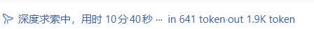
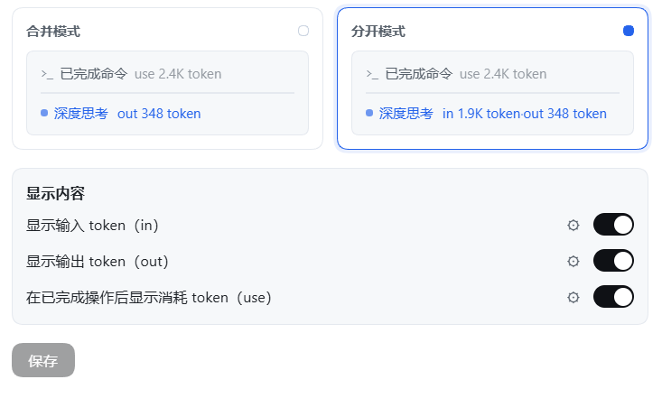

<p align="center">
  
</p>

<div align="center">

# Where Did My Tokens Go?

  **Realtime token badges beside the deep-thinking indicator — merged or split in/out, a think/answer split of the output, auto K/M/G/T units, per-step operation counts**

  [简体中文](README.zh.md) · [MIT License](LICENSE)

  [](LICENSE)
  [](https://www.npmjs.com/package/dsh-where-did-my-tokens-go)
  [](https://github.com/RevxZxCx/dsh-where-did-my-tokens-go)
  [](#installation)
</div>

> Where Did My Tokens Go? is a community-maintained DeepSeek Harness (DSH) plugin, not an official DeepSeek AI product.

This README describes **1.6.2**.

## Features

Put "where did this turn's tokens go" directly in the transcript: a live counter rides the deep-thinking indicator, and every finished operation row is tagged with the cost of its own step. The plugin is global — once installed, every conversation gets it.

- **Live in / out badge**: after the blue 「深度思考 / 深度求索」 ("deep-thinking") indicator, a shimmer-swept badge counts tokens while the model is thinking and streaming. The sweep reuses the platform's own TextShimmer geometry, so the badge reads as part of the same sentence.
  - `in N` = input tokens, `out N` = output tokens, `think N` = the reasoning share of the output.
  - The input figure is the harness's own prompt-size projection (`contextPressure`), so it is live during the input phase without waiting for provider `usage`; once the provider reports `inputTokens`, that authoritative value takes precedence; before either exists, the last known input is reused. Output counts are estimated client-side while streaming (CJK glyph ≈ 1 token, latin ≈ 4 chars/token) and snap to the authoritative value when the stream settles.
- **Think / answer split (configurable, on by default)**: the provider's `reasoningTokens` breaks the output figure into what the model spent *thinking* and what it spent *writing*. `think N` is that reasoning share — it is **part of** `out`, never an extra term, so `out = think + answer` and the visible answer is simply `out − think`. While the model is still thinking, the reasoning text *is* the whole output stream, so the merged badge labels the running number `think`; once the answer starts (or the step settles) the total appears with its `think` share beside it, and split mode shows `in … · out … · think …`. The provider's `reasoningTokens` is authoritative when reported; otherwise the share is estimated from the reasoning stream and clamped to the output total, so it can never exceed the figure it belongs to. A model that streams no reasoning text shows exactly the same badge as before — there is simply no share to print — which is why this is safe to leave on.
- **Auto units (default)**: numbers scale into K (1e3) / M (1e6) / G (1e9) / T (1e12) — `1866 → 1.9K`, `2 500 000 → 2.5M`; below 1000 the raw number shows; a rounding that would print `1000K` promotes to `1M` instead. A gear menu can also **lock** one unit for a site, which then always scales by it.
- **Merged / split display (configurable)**: merged swaps a single label — only `in …` during the input phase, then `think …` while the model is reasoning, then `out …` (with its `think` share) while generating; split shows `in … · out … · think …` together for the whole turn.
- **Four independent switches (configurable)**: show/hide the in, out, think and per-operation labels separately (all on by default). Each switch carries a **gear button** that drops open a per-site editor: **font size** (0/empty = follow the interface text), **color** (native picker plus a "follow theme" reset) and **unit** (auto / K / M / G / T).
- **Per-operation `use N token`**: every completed operation row (「已完成思考」, 「已完成命令」, …) gets a `use N token` label styled like that row, showing **its own step's** tokens (input + output, or the provider's `totalTokens` when it reports one) — never the whole reply's total.
- **Visual settings UI**: a light white/grey, adaptive two-pane layout. Merged and split each get a **preview card that recreates the real transcript scene** (a finished-operation row and the shimmering deep-thinking badge, all with fake data): hovering animates the numbers, clicking switches the display mode, and toggling any switch updates both cards live — unsaved gear choices included, so you see the effect before saving.

## Screenshots

The live badge beside the deep-thinking indicator (split mode):



Each finished operation row tagged with its own step cost:


The settings page with preview cards and switches:



*Screenshots are taken from the 1.6.0 release running on DeepSeek Harness `0.2.0-rc.2`; UI crops keep only the relevant panels, saved as lossless WebP.*

## Installation

Requires a working DeepSeek Harness installation. The commands below use the `desktop` profile; replace it with yours if needed.

### Ask an agent to install it

Send this to an agent that can operate your terminal:

```text
Install the dsh-where-did-my-tokens-go plugin from npm into my DSH profile, verify it is served after the install, and tell me how to reload.
```

### From npm (recommended)

```bash
dsh plugin --profile desktop add dsh-where-did-my-tokens-go
```

### From GitHub

```bash
dsh plugin --profile desktop add github:RevxZxCx/dsh-where-did-my-tokens-go
```

### From source

```bash
# 1. pack the plugin
cd packages/dsh-where-did-my-tokens-go
pnpm pack

# 2. install into the desktop profile
dsh plugin --profile desktop add ./dsh-where-did-my-tokens-go-<version>.tgz
# (or manually: add the tarball to the profile's package.json dependencies and
#  append "dsh-where-did-my-tokens-go" to dsh.profile.bundles, then `pnpm install`)

# 3. restart DSH
```

After installing, **restart DSH** and open any conversation — the badge appears once you send a message. Re-run the install command to update.

- `1.6.2` is tested running on DeepSeek Harness `0.2.0-rc.2` (desktop profile, Windows).

## Usage

| What you want | How |
| --- | --- |
| Watch this turn's in / out tokens | Send a message and read the badge after the 「深度思考」 indicator; it counts in real time. |
| See how much of the output was thinking | Keep the `think` switch on: `think N` is the reasoning share inside `out N`, so the written answer is `out − think`. |
| Switch merged / split | Open **Settings → Token 计数器** and click the matching preview card. |
| Keep only in or only out | Toggle the other switch off — both preview cards drop the segment immediately. |
| See what each finished operation cost | Keep the `use` switch on; every 「已完成…」 row gets its own number. |
| Make big numbers readable | Leave units on auto, or lock K / M / G / T for a site in its gear menu. |
| Restyle one site | Gear → font size / color / unit. `0` and "follow theme" mean no override. |
| Check before saving | Gear edits reflect in the preview cards right away; the chat badge only changes when you press save. |

- **Three configuration entries**: **设置 → Token 计数器** (an own entry in the Settings navigation), the configuration section on this bundle's page in the **插件 / Plugins** panel, and the "Token 计数器" card in that panel's **官方 / Official** group. All three open the same form.
- **Unsaved drafts never leak**: preview and gear edits are staged inside the form; the live badge renders only saved configuration; "save" writes the host config, "discard" reverts everything at once.
- **Fixed units still promote stepwise**: locking `K` on an extreme number never prints `1000K`; it keeps promoting upward (capped at `1000T`).
- **`think` is a share, not a term**: it comes from the provider's `reasoningTokens`, which the platform validates to be `<= outputTokens`. Adding `out + think` double-counts; the answer is `out − think`. When the provider reports no `reasoningTokens`, the share is estimated from the reasoning stream and clamped to `out`; a model that streams no reasoning text shows no `think` segment at all.
- **Reduced motion**: with the system "reduce motion" preference, the sweep decoration is dropped and the numbers stay visible.
- **Color inside the sweep**: while the highlight band passes over the badge it shows the row's shimmer tint (same behavior as the official indicator); font size and unit always apply.

## How it works

- The browser half subscribes to the DSH client `sessions` service and the active (main-view) session's `binding.eventSource`.
- It counts `text-delta` / `reasoning-delta` stream chunks as they arrive (the reasoning text feeds both the output total and its own breakdown), reads the live input count from the harness's `contextPressure` projection, and records authoritative `usage` per step from the `usage` chunk / `assistant/message` event (keyed by turn + step), including `reasoningTokens`.
- It injects a DOM badge into the running indicator (there is no slot around it), rebuilt as two counter-moving layers mirroring the platform TextShimmer so the glyphs stay still while the highlight travels. Each completed operation row is one step, so rows walked in document order claim the next settled step of their turn.
- The host half declares the options schema with schemastery (17 fields); the settings form reads and writes the same namespace through `configForms`.

## Package layout

- `lib/index.js` — host half: schemastery `Config` + `apply`.
- `lib/client.js` — browser half via `window.__ModuleLoader__.load`.
- `cordis.patch.yml` — registers the plugin profile entry.
- `package.json` — `dsh.bundle` + `dsh.client = { platform: "web", inject: [...] }`.

## Development

```bash
node test/run-tests.mjs    # mocked-browser unit tests (~480 assertions, covers every feature)
node test/probe-served.mjs # checks the running DSH serves the current on-disk client build
```

## Feedback & contribution

Issues and suggestions are welcome on [GitHub Issues](https://github.com/RevxZxCx/dsh-where-did-my-tokens-go/issues) — please include your DSH and plugin versions and steps to reproduce; full screenshots help for UI problems. If the settings form reports "This plugin is not loaded, so it cannot be configured right now", the host half is not mounted — run `dsh --profile desktop --dump-config` (or check the profile's `cordis.patch.yml`) before filing an issue.

## License

[MIT](LICENSE)
